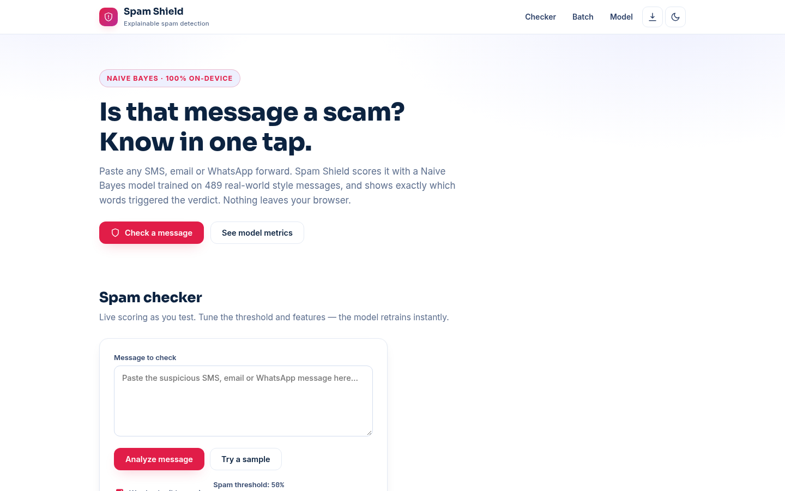
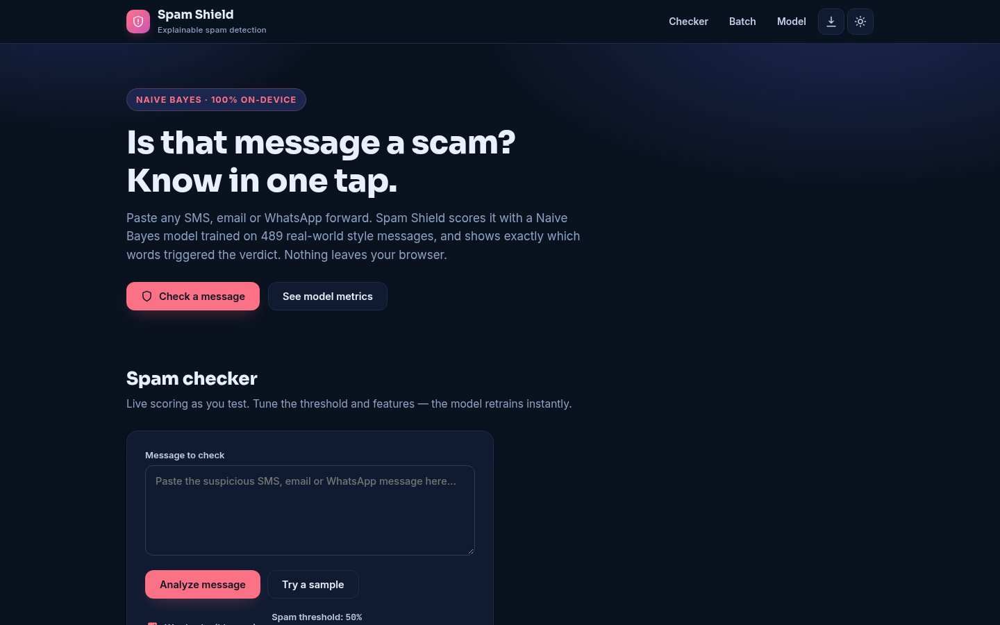
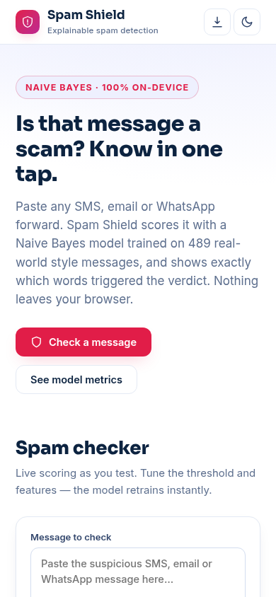

# Spam Shield — Explainable AI Spam Detector

**Live:** https://akash991833.github.io/spam-shield/

Paste any SMS, email or WhatsApp forward and get an instant spam verdict with the exact words that caused it. A Naive Bayes text classifier trains **in your browser** on a 489-message labeled corpus (public SMS Spam Collection style + common Indian scam patterns: fake KYC, lottery, advance-fee, OTP fraud). Nothing is uploaded, no sign-up, 100% free.



## Features

- **Single message checker** — spam probability gauge, verdict, and per-word highlighting (red = pushed toward spam, green = pushed toward safe)
- **Explainable AI** — top contributing words shown for every verdict
- **Batch screening** — paste a list, screen all at once, export results as CSV
- **Model metrics page** — real held-out test-split numbers: accuracy, precision, recall, F1, confusion matrix, strongest spam signals
- **Tunable model** — spam threshold slider, bigram (word-pair) features toggle; the model retrains live
- **Dark + light mode**, installable PWA, works offline after first load
- Fully responsive: desktop and mobile

 

## How it works

1. Messages are tokenized with special tokens for URLs, money amounts, OTP-length numbers, phone numbers, ALL-CAPS and repeated exclamation marks.
2. A multinomial Naive Bayes model (Laplace smoothing, optional bigrams) trains on the labeled corpus in milliseconds.
3. Classification uses log-probabilities with a sigmoid to produce a calibrated-looking spam probability.
4. Metrics are computed on a seeded, stratified 80/20 train/test split — the numbers on the Model page are genuinely held-out.

## Honest limits

This is a demo-scale model trained on ~489 messages, not a carrier-grade filter (~83% held-out accuracy). It catches obvious scam patterns but can miss new or subtle attacks. Never share OTPs, PINs or card details based on any tool's verdict — verify with the official app or helpline.

## Tech

Vanilla HTML/CSS/JS, zero build step, zero dependencies, zero servers. Hosted free on GitHub Pages.

## Run locally

```bash
python3 -m http.server 8000
# open http://localhost:8000
```

---

Built by [Akash Vishwakarma](https://github.com/AKASH991833)
